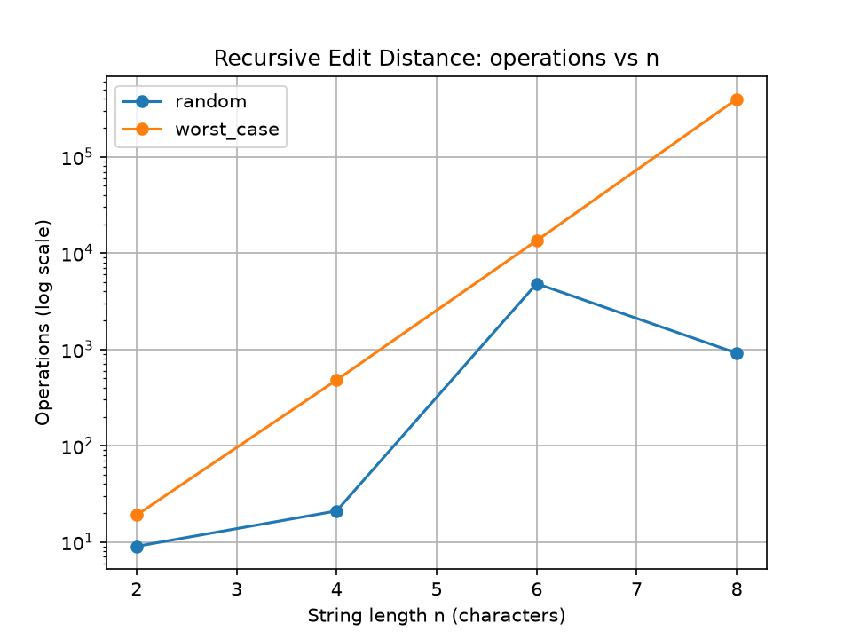
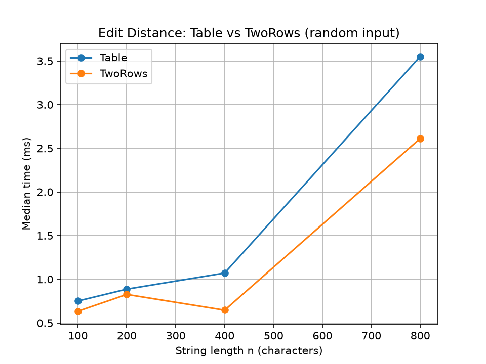
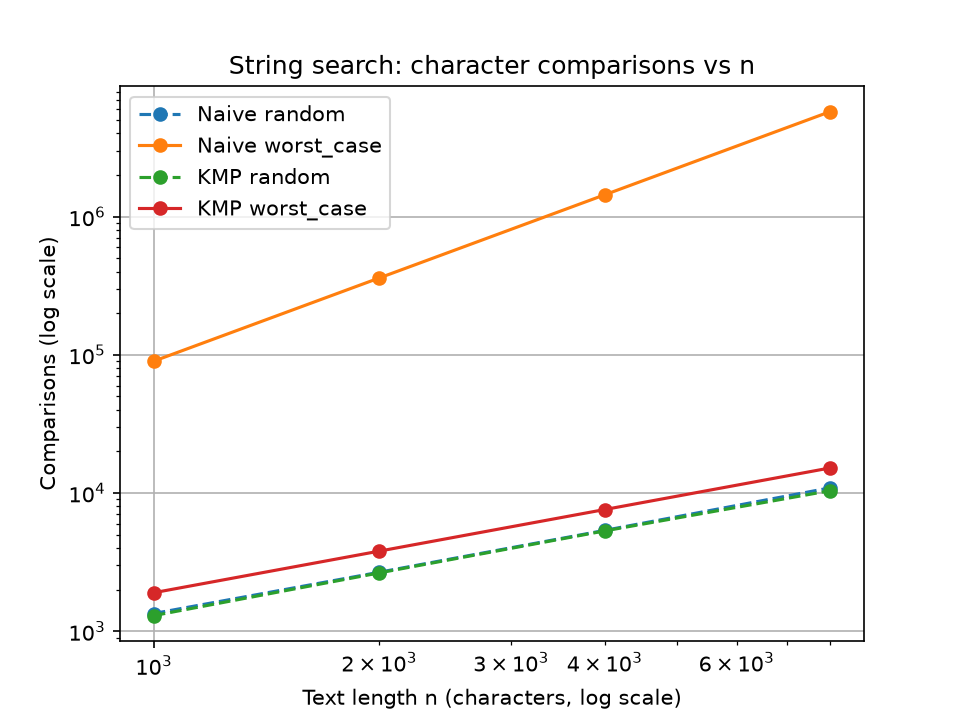
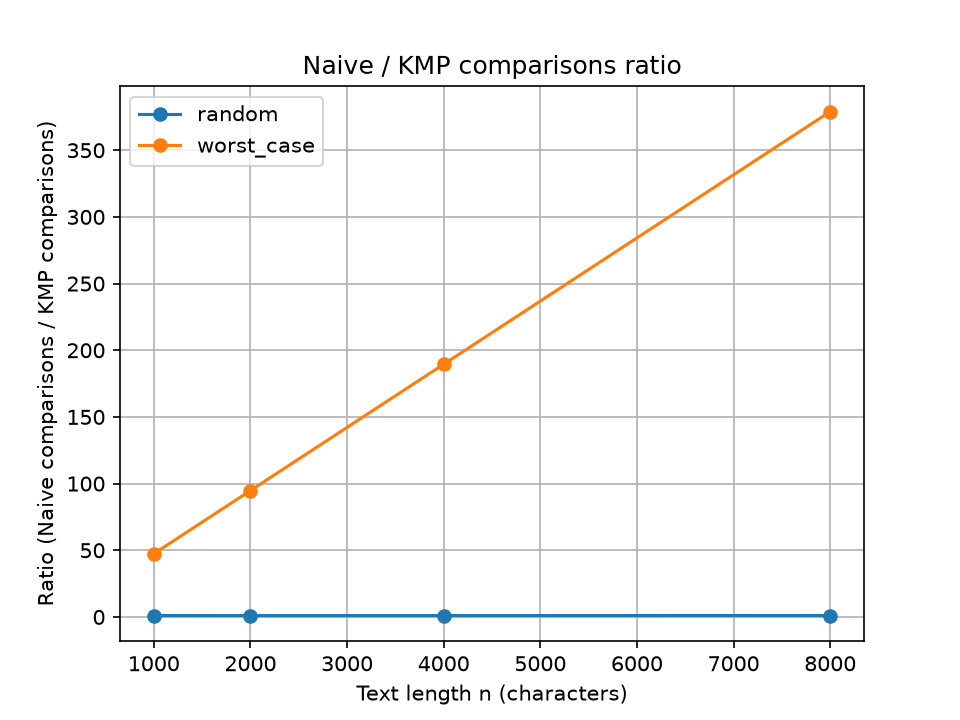

# Report: Assignment 4 

## Experiment Design Card
| Field | Content |
|---|---|
| Question | Edit Distance: does Recursive grow exponentially while Table and TwoRows grow as n·m? String search: does Naive reach O(n·m) in the worst case while KMP stays O(n)? |
| Sizes | Edit Distance: Recursive n = 2, 4, 6, 8 (larger sizes cannot finish); Table and TwoRows n = 2, 4, 6, 8, 100, 200, 400, 800. Search: n = 1000, 2000, 4000, 8000 (pattern length n/10). |
| Inputs | random: strings over the alphabet {A, B, C}, seed 42 (typical case). worst_case for Edit Distance: "A"*n vs "B"*n, every character differs. worst_case for search: text "A"*n, pattern "A...AB", so Naive almost matches at every start position. |
| Metrics | Counter inside the algorithm (operations for Edit Distance, character comparisons for search), because it does not depend on the laptop. Time: median of 5 runs. |
| Prediction | Recursive: exponential growth. Table and TwoRows: quadratic, with the same counters. Naive worst case: quadratic. KMP: linear on every input. |
| Plots | 1: Recursive growth (log axis). 2: Table vs TwoRows time. 3: search comparisons (log-log). 4: Naive/KMP ratio. |

## Plots and Results

Takeaway: on the worst-case input the number of operations grows from 19 (n=2) to 398,593 (n=8), about 28 times per 2 extra characters.

Takeaway: Table and TwoRows have similar times, and both grow with n·m (about 3.5 ms and 2.6 ms at n=800).

Takeaway: Naive worst case grows 4 times when n doubles (90,100 to 5,760,800), while KMP grows only 2 times (1,901 to 15,201).

Takeaway: on the worst case Naive needs 47 times more comparisons than KMP at n=1000 and 379 times more at n=8000; on random input the ratio stays near 1.

## Prediction vs Result
- **Edit Distance.** Expected: Recursive exponential, Table and TwoRows quadratic. Saw: on worst_case Recursive went 19, 481, 13,483, 398,593, which is exponential. Table counters were 10,202 / 40,402 / 160,802 / 641,602 for n = 100 / 200 / 400 / 800, so they grow 4 times when n doubles, which is quadratic. TwoRows has the same counters, each one smaller by 1. Surprise: on random input Recursive is not monotonic (4,828 operations at n=6, only 913 at n=8). The reason is that random strings differ between sizes, and the recursion cost depends on the actual characters, so one random pair can be cheaper than a shorter one. This is also why worst_case is the better input for showing growth.
- **String search.** Expected: Naive quadratic on the worst case, KMP linear. Saw exactly that: Naive worst case 90,100 / 360,200 / 1,440,400 / 5,760,800, KMP worst case 1,901 / 3,801 / 7,601 / 15,201 (about 2n). On random input both need about 1.3·n comparisons, so random input hides the difference completely.

## Short Answers
1. **Slowest input for search.** Text "A"*n with pattern "A...AB". Naive matches almost the whole pattern at every start position and fails only on the last character, so it does about n·m comparisons (5,760,800 at n=8000, 9.3 ms). KMP uses the LPS array to avoid re-checking and did only 15,201 comparisons.
2. **Recursive limit.** I ran it only up to n=8 (398,593 operations on the worst case, 3 ms). The count grew about 28 times per 2 characters, so n=100 would never finish, because the same subproblems are recomputed without memory. That is why I stopped at n=8.
3. **Two rows.** Gain: the extra memory is O(m) instead of O(n·m), and it was slightly faster in my runs (2.6 ms vs 3.5 ms at n=800). Loss: the full table is gone, so the sequence of edits cannot be recovered by backtracking, only the distance.
4. **My choice for the city platform.** KMP. Its worst case stays linear, so a long log file with repeated patterns cannot make it slow, while Naive has a quadratic worst case (379 times more comparisons at n=8000). Naive is simpler, but I prefer the guaranteed bound.

## Time
Measured times were small: Table about 3.5 ms and TwoRows about 2.6 ms at n=800, Naive worst case 9.3 ms and KMP worst case 0.04 ms at n=8000. Many values are well below 1 ms and noisy (for example Table random n=100 took 0.75 ms but worst_case only 0.25 ms, caused by JIT warm-up and other programs), so time alone is not reliable evidence. The counters are measured inside the algorithms and do not depend on the laptop, so they are my main evidence.